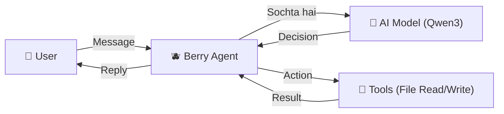
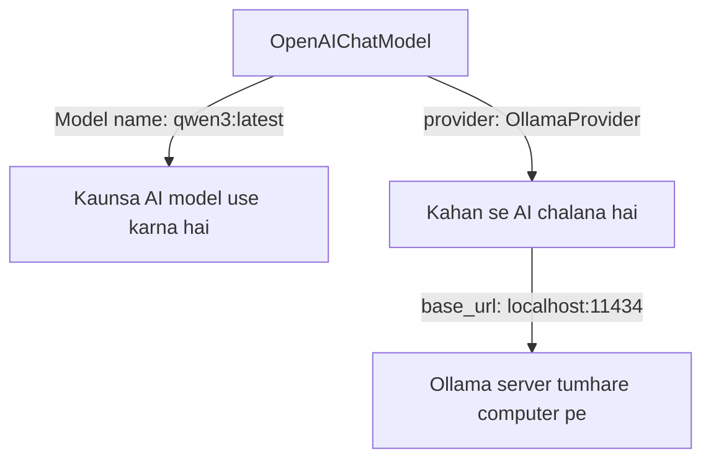
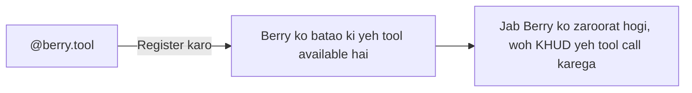
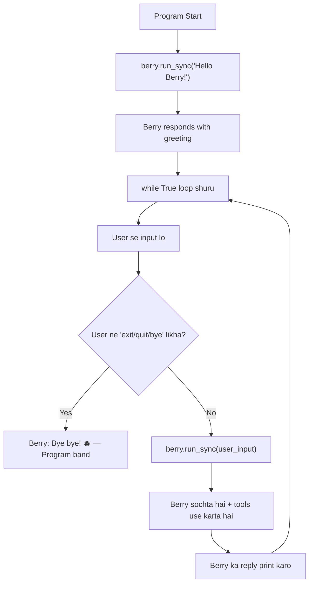
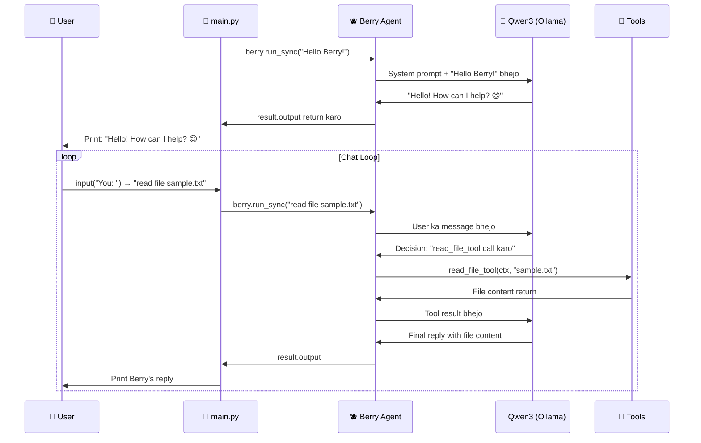

# 🫐 Berry AI Agent — Complete A to Z Guide

## 🧠 Sabse Pehle: AI Agent Kya Hota Hai?

Ek **AI Agent** ek aisi program hai jo:
1. **Sochti hai** (LLM/AI model use karke)
2. **Actions leti hai** (tools use karke — jaise file read/write karna)
3. **User se baat karti hai** (input/output ke through)



> [!IMPORTANT]
> Ek normal chatbot sirf baat karta hai. Lekin ek **Agent** baat bhi karta hai AUR **kaam bhi karta hai** (files read/write, search, etc.)

---

## 📁 Project Structure — Kya File Kya Kaam Karti Hai

```
Berry/
├── .venv/                  ← Python virtual environment (packages installed here)
├── tools/                  ← Agent ke tools (capabilities) ka folder
│   ├── __init__.py         ← Python ko bolta hai "yeh ek package hai"
│   └── file_tools.py       ← File read/write functions
├── main.py                 ← 🏠 Main file — Berry agent yahan define hota hai
├── ui.py                   ← (Abhi khali hai — future mein UI yahan banegi)
└── sample.txt              ← Test file
```

---

## 🔬 Code Breakdown — Line by Line Samjho

### 📄 File 1: `main.py` — Berry Ka Dimaag

Yeh file 4 kaam karti hai:
1. AI Model setup karna
2. Agent banana
3. Tools register karna
4. Chat loop chalana

---

### STEP 1: Imports — Libraries Lana

```python
from pydantic_ai import Agent 
from pydantic_ai.models.openai import OpenAIChatModel
from pydantic_ai.providers.ollama import OllamaProvider 

from tools.file_tools import read_file, write_file
```

| Import | Kya Karta Hai |
|--------|--------------|
| `Agent` | Yeh hai **pydantic-ai** ka main class — isse agent banta hai |
| `OpenAIChatModel` | AI model ka wrapper — OpenAI-compatible models ke liye |
| `OllamaProvider` | Ollama (local AI) se connect karne ka raasta |
| `read_file, write_file` | Tumhare custom tools jo file read/write karte hain |

> [!NOTE]
> **pydantic-ai** ek Python framework hai jo AI agents banana easy banata hai. Yeh handle karta hai:
> - Model se baat karna
> - Tools manage karna  
> - Response parse karna

---

### STEP 2: AI Model Setup — Berry Ka Dimaag Lagana

```python
model = OpenAIChatModel(
    "qwen3:latest",
    provider=OllamaProvider(
        base_url="http://localhost:11434/v1"
    )
)
```

Yeh samjho aise:



| Cheez | Matlab |
|-------|--------|
| `OpenAIChatModel` | OpenAI-compatible format mein model use karo |
| `"qwen3:latest"` | Qwen3 model use karo (Ollama pe installed hona chahiye) |
| `OllamaProvider` | Bolta hai "AI model Ollama se lao" (cloud se nahi) |
| `base_url` | Ollama ka address — tumhare computer pe port 11434 pe chalta hai |

> [!TIP]
> **Ollama** ek tool hai jo AI models tumhare **apne computer pe** chalata hai — FREE mein, bina internet ke! 
> Terminal mein `ollama run qwen3` se model download/run hota hai.

---

### STEP 3: Agent Banana — Berry Ko Life Dena

```python
berry = Agent(
    model,
    system_prompt="""
    You are BERRY, a personal AI assistant.
    You can read and write files when necessary.
    """
)
```

| Parameter | Kya Hai |
|-----------|---------|
| `model` | Step 2 mein banaya hua AI model — Berry ka **dimaag** |
| `system_prompt` | Berry ko batao **"tu kaun hai, tera kaam kya hai"** |

> [!IMPORTANT]
> **System Prompt** bahut important hai! Yeh agent ki **personality** aur **rules** define karta hai.
> 
> Jaise agar tum likho:
> - *"You are a rude assistant"* → Berry rude baatein karega
> - *"You are BERRY, a personal AI assistant"* → Berry helpful aur friendly hoga
> 
> Yeh prompt **har conversation** mein background mein rehta hai.

---

### STEP 4: Tools Register Karna — Berry Ko Powers Dena

```python
@berry.tool
def read_file_tool(ctx, filename: str) -> str:
    return read_file(filename)


@berry.tool
def write_file_tool(ctx, filename: str, content: str) -> str:
    return write_file(filename, content)
```

Yeh samjho:



| Cheez | Matlab |
|-------|--------|
| `@berry.tool` | **Decorator** — Berry ko bolta hai "yeh ek tool hai jo tu use kar sakta hai" |
| `ctx` | **Context** — pydantic-ai ka required parameter (agent ka internal state) |
| `filename: str` | Parameter with **type hint** — AI ko batata hai "yahan file ka naam dena hai (string mein)" |
| `-> str` | Return type — AI ko batata hai "yeh tool string return karega" |

> [!NOTE]
> **Berry KHUD decide karta hai kab tool use karna hai!**
> 
> Agar user bole: *"read the file notes.txt"*
> - Berry sochega: "Hmm, file read karni hai, mere paas `read_file_tool` hai"
> - Berry **automatically** call karega: `read_file_tool(ctx, "notes.txt")`
> - Result aayega, Berry user ko batayega
> 
> Agar user bole: *"Hello!"*
> - Berry sochega: "Yeh toh normal greeting hai, koi tool ki zaroorat nahi"
> - Berry directly reply karega: "Hi! How can I help?"

---

### STEP 5: Agent Chalana — Berry Se Baat Karna

```python
# Pehla message — one-time greeting
result = berry.run_sync("Hello Berry!")
print(result.output)

# Continuous chat loop
while True:
    user_input = input("You: ")
    if user_input.lower() in ["exit", "quit", "bye"]:
        print("Berry: Bye bye! 🫐")
        break
    result = berry.run_sync(user_input)
    print(f"Berry: {result.output}")
```



| Method | Kya Karta Hai |
|--------|--------------|
| `berry.run_sync()` | Berry ko message bhejo aur **wait karo** jab tak reply na aaye |
| `result.output` | Berry ka final reply (text string) |
| `input("You: ")` | Terminal mein user se input lo |

> [!TIP]
> `run_sync` = **Synchronous** run — program ruk jaata hai jab tak Berry reply na de.
> Ek `run` method bhi hota hai jo **async** hota hai (advanced use ke liye).

---

### 📄 File 2: `tools/file_tools.py` — Berry Ki Powers

```python
from pathlib import Path


def read_file(filename: str) -> str:
    path = Path(filename)

    if not path.exists():
        return "File does not exist."

    return path.read_text()


def write_file(filename: str, content: str) -> str:
    path = Path(filename)

    path.write_text(content)

    return f"File {filename} written successfully."
```

| Function | Kya Karti Hai |
|----------|--------------|
| `read_file("notes.txt")` | File ka content padh ke return karti hai |
| `write_file("notes.txt", "Hello")` | File mein content likh deti hai |
| `Path(filename)` | Python ka **pathlib** — file paths handle karne ka safe tarika |

> [!NOTE]
> Yeh functions **alag file** mein hain (`tools/file_tools.py`) kyunki:
> 1. **Code organized** rehta hai — har cheez ek jagah
> 2. **Reusable** hai — doosri jagah bhi import kar sakte ho
> 3. **Easy to test** — alag se test kar sakte ho

---

### 📄 File 3: `tools/__init__.py` — Package Identifier

Yeh file **khali** hai lekin bahut **important** hai!

```python
# (empty file)
```

> [!IMPORTANT]
> Bina `__init__.py` ke Python `tools/` folder ko **package nahi manega**!
> 
> Matlab yeh import **FAIL** ho jayega:
> ```python
> from tools.file_tools import read_file  # ❌ ModuleNotFoundError
> ```
> `__init__.py` daalte hi Python samajh jaata hai "haan, `tools` ek package hai, iske andar files import kar sakte ho."

---

## 🔄 Poora Flow — Jab Berry Chalta Hai

Jab tum `python main.py` run karte ho:



---

## 🧩 Key Concepts Summary

### 1. LLM (Large Language Model)
- Woh AI model jo **sochta** hai — tumhare case mein **Qwen3**
- Ollama ke through locally run hota hai

### 2. Agent
- LLM + Tools + System Prompt = **Agent**
- Agent sirf baat nahi karta, **kaam bhi karta hai**

### 3. System Prompt
- Agent ki **personality** aur **rules**
- Background mein hamesha rehta hai

### 4. Tools (Function Calling)
- Agent ke **haath** — jisse woh kaam karta hai
- AI **khud decide** karta hai kaunsa tool kab use karna hai
- `@berry.tool` decorator se register hote hain

### 5. Provider
- **Kahan se** AI model access karna hai
- Tumhare case mein: Ollama (local) via `OllamaProvider`

### 6. run_sync
- Agent ko message bhejo aur reply lo
- **Synchronous** — program wait karta hai

---

## 🗺️ Aage Kya Kar Sakti Ho?

| Feature | Kaise Karein |
|---------|-------------|
| 🌐 **Web Search Tool** | Naya tool banao jo web search kare |
| 💾 **Memory/History** | Previous messages save karo taaki Berry yaad rakhe |
| 🎨 **UI (Streamlit/Gradio)** | `ui.py` mein web interface banao |
| 📊 **More Tools** | Calculator, weather, reminder tools add karo |
| 🔗 **Multi-Agent** | Multiple agents banao jo ek doosre se baat karein |

---

> [!TIP]
> **Quick Recap Formula:**
> ```
> Berry = Qwen3 (Brain) + Tools (Hands) + System Prompt (Personality) + Chat Loop (Conversation)
> ```
> Bas itna hi hai! 🫐
