# 🫐 Berry AI — Streaming + QThread + Signals Complete Guide

## 🎯 Yeh Guide Kiske Liye Hai?

Berry ka pehla guide tha **"Agent kya hai, kaise banta hai"**. Ab yeh guide hai:
- **Streaming** — AI ka reply ek ek chunk mein aana (jaise ChatGPT mein text gradually appear hota hai)
- **Buffer** — aaye hue chunks ko collect karna
- **async/await** — bina ruke multiple kaam karna
- **QThread** — background mein heavy kaam karna taaki UI freeze na ho
- **Signals** — background thread se UI ko safely update karna

> [!IMPORTANT]
> Yeh guide tumhare **actual code** (`main.py` + `ui.py`) ke basis pe likhi gayi hai. Har concept ko pehle samjhao, phir code mein dikhao.

---

## 🧠 Pehle Concepts Samjho — Phir Code Dekhenge

---

### Concept 1: Synchronous vs Streaming — Farak Kya Hai?

#### ❌ Synchronous (Purana Tarika — `run_sync`)

```
User: "Tell me about Python"
        ⏳ ... 10 second wait (kuch dikhta nahi) ...
Berry: "Python is a programming language that was created by..."  ← POORA reply ek baar mein
```

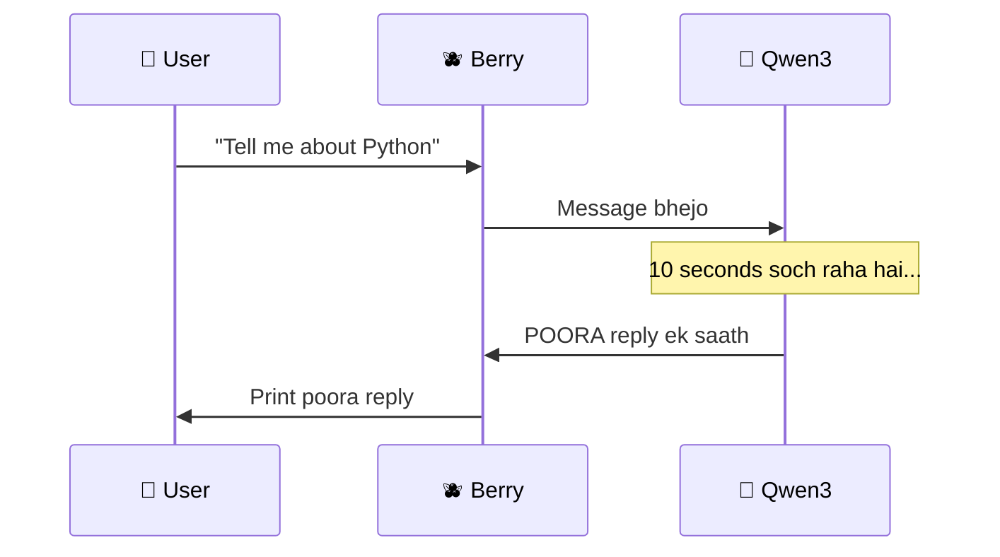

#### ✅ Streaming (Naya Tarika — `run_stream`)

```
User: "Tell me about Python"
Berry: "Python"
Berry: "Python is"
Berry: "Python is a programming"
Berry: "Python is a programming language"
Berry: "Python is a programming language that was..."  ← WORD BY WORD aa raha hai!
```

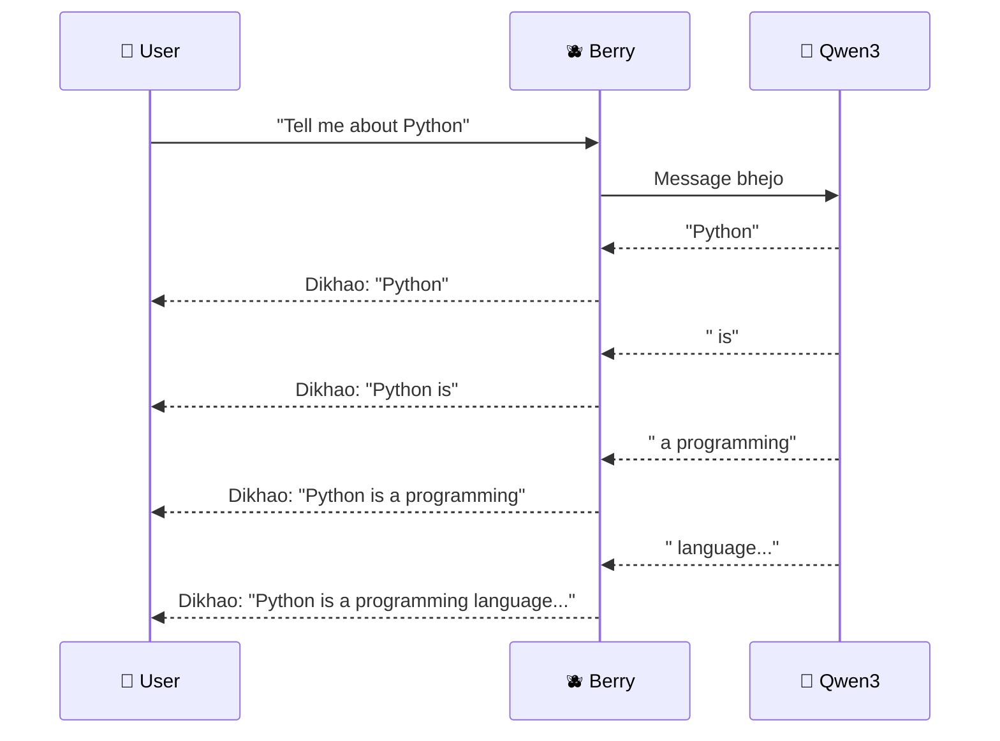

> [!TIP]
> **Streaming = AI sochte sochte bolta jaata hai.** User ko lagta hai Berry fast hai kyunki text turant dikhne lagta hai — even though poora reply abhi bhi 10 second lagega!

---

### Concept 2: `async` / `await` — Bina Ruke Kaam Karna

#### Problem: Normal Python ek ek kaam karta hai

```python
# ❌ Normal (Synchronous)
data1 = download_file("a.txt")     # 5 sec wait
data2 = download_file("b.txt")     # 5 sec wait
# Total: 10 seconds 😩
```

#### Solution: `async` se Python ek kaam ke wait mein doosra kaam kar sakta hai

```python
# ✅ Async
data1 = await download_file("a.txt")   # Start karo, wait ke time doosra karo
data2 = await download_file("b.txt")   # Dono milke ~5 sec! 🚀
```

#### Key Words:

| Keyword | Kya Karta Hai |
|---------|---------------|
| `async def` | Bolta hai "yeh function async hai — iske andar `await` use hoga" |
| `await` | Bolta hai "yeh kaam hone tak ruko, lekin ruke hue time mein doosra kaam ho sakta hai" |
| `async for` | Bolta hai "ek loop hai jahan har iteration mein wait ho sakta hai" (streaming ke liye perfect!) |
| `async with` | Bolta hai "yeh ek context manager hai jo async hai" (connection open/close ke liye) |
| `asyncio.run()` | Async code ko **normal Python** se chalane ka gateway |

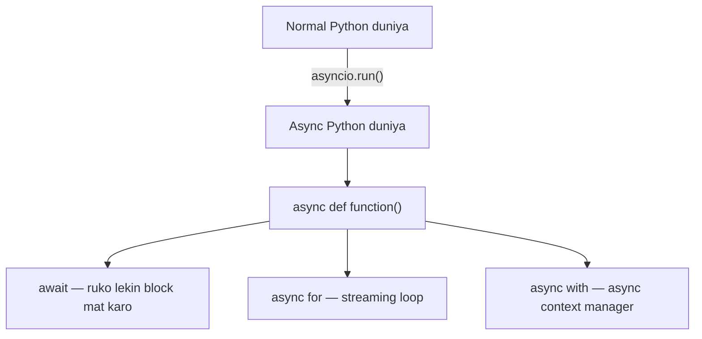

> [!NOTE]
> **Streaming ke liye `async` ZARURI hai** kyunki:
> - AI se data **thoda thoda** aata hai (chunks mein)
> - Har chunk ke beech **wait** hota hai
> - `async for` se hum har chunk process karte hain bina poore program ko roke

---

### Concept 3: `yield` — Generator Function

Normal function ek baar `return` karta hai aur khatam. `yield` wala function **baar baar** values deta hai:

```python
# Normal function — ek baar return, khatam
def get_name():
    return "Berry"

# Generator function — baar baar yield, ruk ruk ke deta hai
def get_names():
    yield "Berry"    # pehli value do, ruko
    yield "Cherry"   # doosri value do, ruko
    yield "Merry"    # teesri value do, khatam
```

```python
for name in get_names():
    print(name)
# Output:
# Berry
# Cherry
# Merry
```

#### `async yield` — Streaming ke liye:

```python
async def stream_berry(message):
    async for chunk in result.stream_text():
        yield chunk   # har chunk aate hi bahar bhej do!
```

> [!IMPORTANT]
> `yield` ka matlab hai: **"yeh value de do, lekin function khatam mat karo — agli value ke liye wapas aaunga"**
>
> Isliye `stream_berry()` ek **async generator** hai — har chunk aate hi yield karta hai, poore reply ka wait nahi karta!

---

### Concept 4: Buffer — Chunks Ko Collect Karna

Imagine AI se chunks aate hain: `"Py"`, `"thon"`, `" is"`, `" great"`

**Buffer** = ek variable jo sab chunks ko **jodta** jaata hai:

```
Chunk 1 aaya: "Py"       → Buffer: "Py"
Chunk 2 aaya: "thon"     → Buffer: "Python"
Chunk 3 aaya: " is"      → Buffer: "Python is"
Chunk 4 aaya: " great"   → Buffer: "Python is great"
```

```python
buffer = ""                    # Khali buffer
buffer += "Py"                 # "Py"
buffer += "thon"               # "Python"
buffer += " is"                # "Python is"
buffer += " great"             # "Python is great"
```

> [!NOTE]
> Buffer ka use: Streaming ke baad tumhare paas **poora reply** hota hai history mein save karne ke liye. Bina buffer ke, tumhare paas sirf aakhri chunk hoga!

---

### Concept 5: QThread — Background Worker

#### ❌ Problem: UI Freeze

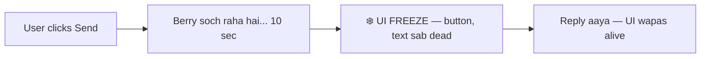

Agar Berry ka kaam **main thread** mein karo, toh jab tak Berry soch raha hai, **poora UI freeze** ho jaata hai — button click nahi hoga, text type nahi hoga, window drag nahi hogi!

#### ✅ Solution: QThread — Alag Thread Mein Kaam Karo

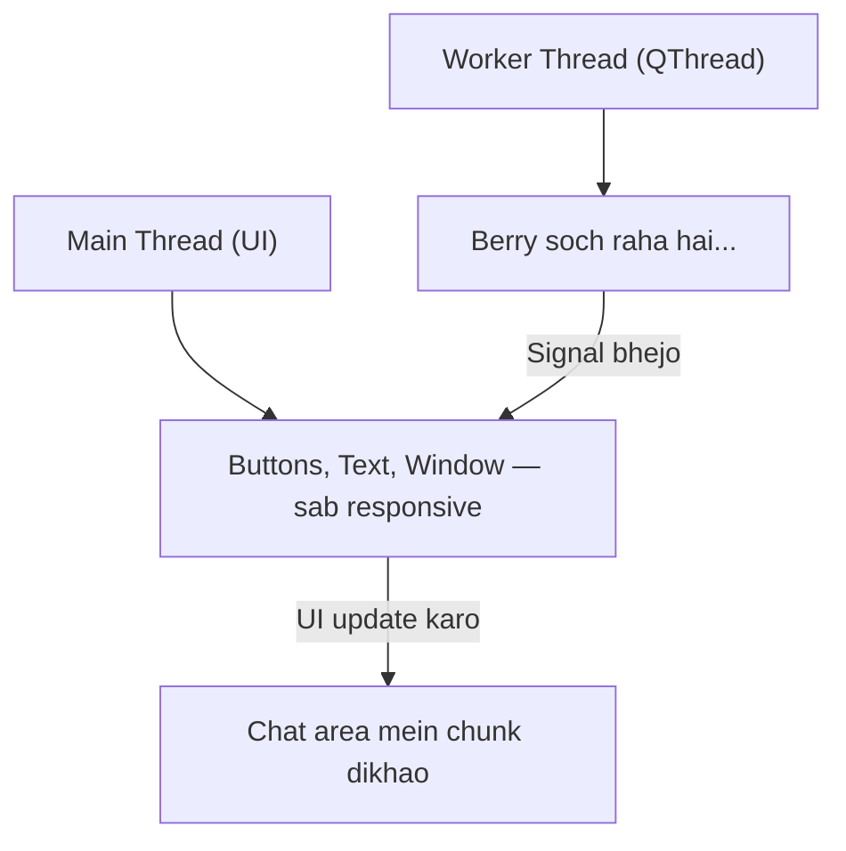

| Cheez | Kya Hai |
|-------|---------|
| **Main Thread** | UI ka thread — buttons, text area, window sab yahan hai. **ISKO BLOCK NAHI KARNA!** |
| **QThread** | Ek alag thread jo **background mein** heavy kaam karta hai |
| **`run()` method** | QThread ka main function — jab `worker.start()` karo, yeh background mein chalta hai |

> [!CAUTION]
> **KABHI BHI** background thread se directly UI update mat karo! Qt mein UI elements sirf **main thread** se update ho sakte hain. Isliye **Signals** use karte hain!

---

### Concept 6: Signals — Thread Se UI Ko Message Bhejna

**Signal** = Qt ka messaging system. Background thread se main thread ko **safely** baat karne ka tarika.

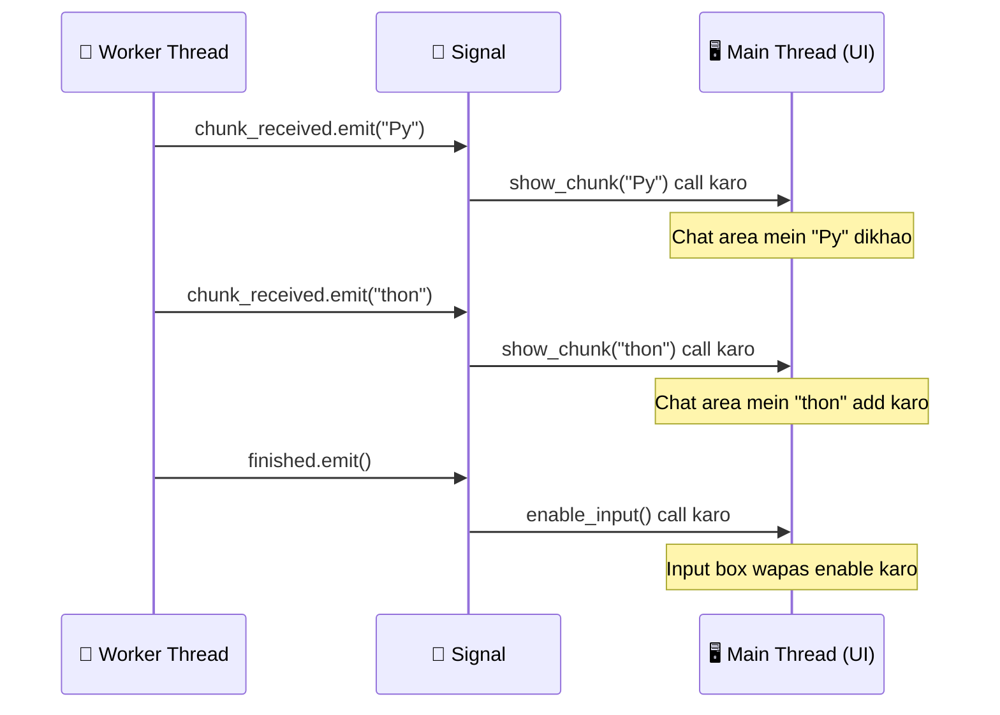

| Cheez | Kya Hai |
|-------|---------|
| `Signal(str)` | Ek signal define karo jo **string data** bhej sakta hai |
| `Signal()` | Ek signal define karo jo **bina data** ke fire hota hai |
| `.emit("data")` | Signal ko **fire** karo — "yeh data bhej do connected function ko!" |
| `.connect(function)` | Signal ko ek function se **jod do** — "jab yeh signal fire ho, yeh function chala do" |

> [!TIP]
> **Signal-Slot samjho aise:**
> - **Signal** = Doorbell (ghanti) 🔔
> - **Slot** = Darwaza kholne wala function 🚪
> - **Connect** = Ghanti ko darwaze se jod do 🔗
> - **Emit** = Ghanti bajao! 🔔➡️🚪
>
> Jab ghanti baje (emit), darwaza khulta hai (function call hota hai)!

---

### Concept 7: `delta=True` — Poora vs Naya

`stream_text()` mein `delta=True` ka matlab:

| Mode | Kya Milta Hai | Example |
|------|--------------|---------|
| `delta=False` (default) | Har baar **ab tak ka poora text** | `"Py"` → `"Python"` → `"Python is"` → `"Python is great"` |
| `delta=True` ✅ | Sirf **naya aaya hua piece** | `"Py"` → `"thon"` → `" is"` → `" great"` |

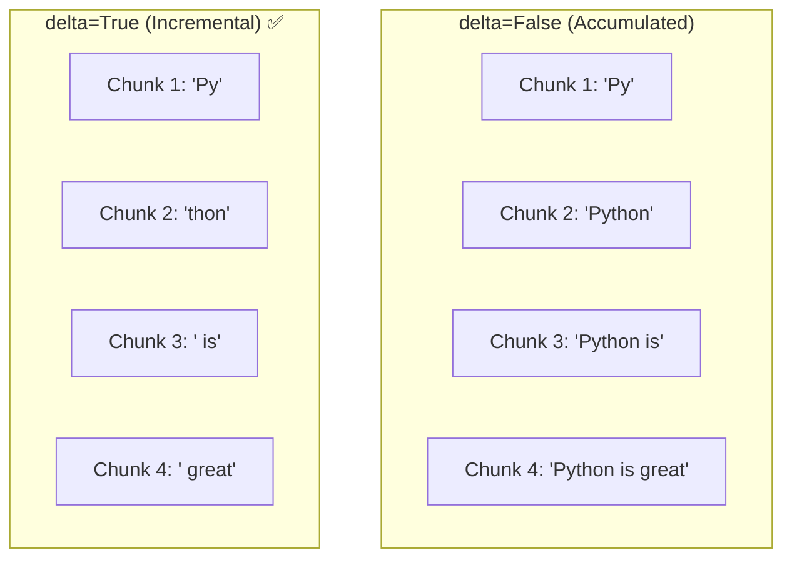

> [!IMPORTANT]
> Hum `delta=True` use karte hain kyunki hum har chunk ko **add** karte hain chat area mein. Agar `delta=False` hota toh har baar **poora text replace** karna padta — bahut wasteful!

---

## 🔬 Ab Code Samjho — Line by Line

---

### 📄 File 1: `main.py` — Streaming Function

Pehle ka code (`Agent` setup, tools, etc.) toh tumne pehli guide mein samajh liya. Ab naye parts dekhte hain:

---

#### Part A: `ask_berry()` — Purana Synchronous Tarika

```python
history = []

def ask_berry(user_message):
    global history
    result = berry.run_sync(user_message, message_history=history)
    history = result.all_messages()
    return result.output
```

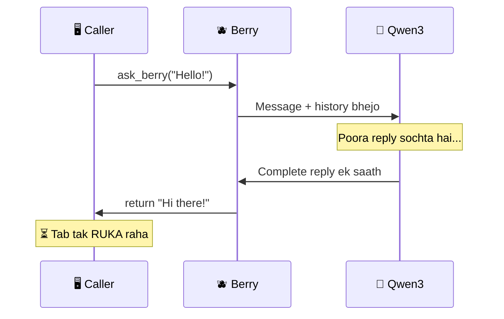

| Line | Kya Karta Hai |
|------|---------------|
| `history = []` | **Global** list jo poore conversation ki history rakhta hai |
| `global history` | Function ke andar bolta hai "main `history` ko modify karunga, naya local variable mat banao" |
| `berry.run_sync(...)` | Berry ko message bhejo aur **ruko** jab tak POORA reply na aaye |
| `message_history=history` | Pehle ki baatein bhi bhejo taaki Berry ko context mile |
| `result.all_messages()` | Is conversation ke saare messages nikalo (user + berry dono ke) — next time history mein bhejenge |
| `return result.output` | Berry ka final reply return karo |

> [!NOTE]
> **`message_history` kyun zaruri hai?**
>
> Bina history ke:
> ```
> You: "Mera naam Mathely hai"
> Berry: "Nice to meet you Mathely!"
> You: "Mera naam kya hai?"
> Berry: "Mujhe nahi pata 🤷"  ← History nahi thi toh bhool gaya!
> ```
>
> History ke saath:
> ```
> You: "Mera naam Mathely hai"
> Berry: "Nice to meet you Mathely!"
> You: "Mera naam kya hai?"
> Berry: "Tumhara naam Mathely hai! 😊"  ← History thi toh yaad raha!
> ```

---

#### Part B: `stream_berry()` — Naya Streaming Tarika ⭐

```python
async def stream_berry(user_message):
    global history
    buffer = ""

    async with berry.run_stream(
        user_message, message_history=history
    ) as result:
        async for chunk in result.stream_text(delta=True):
            buffer += chunk
            yield chunk
        history = result.all_messages()
```

Yeh function BOHOT important hai. Ek ek line samjhte hain:

| Line | Kya Karta Hai |
|------|---------------|
| `async def stream_berry(...)` | **Async generator function** — yield karega, await karega |
| `buffer = ""` | Khali string — chunks collect karne ke liye |
| `async with berry.run_stream(...) as result` | Berry se streaming connection kholo. `async with` ensure karta hai ki connection properly close ho |
| `async for chunk in result.stream_text(delta=True)` | Har naya chunk aate hi loop chale — ruk ruk ke chunks aate hain |
| `buffer += chunk` | Naya chunk buffer mein jodo (future use ke liye — poora reply rakhna) |
| `yield chunk` | Chunk ko **turant bahar bhej do** — caller ko milega abhi ke abhi! |
| `history = result.all_messages()` | Streaming khatam hone ke baad history update karo |

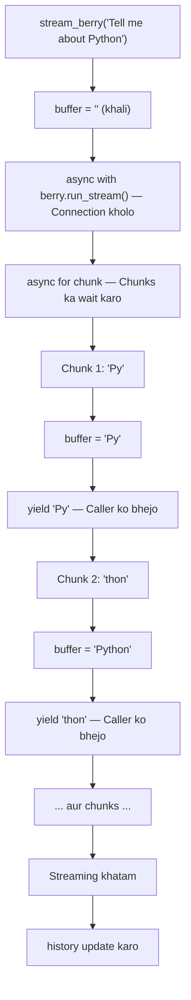

> [!IMPORTANT]
> **`run_sync` vs `run_stream` — Side by Side:**
>
> | Feature | `run_sync` | `run_stream` |
> |---------|-----------|-------------|
> | Reply kab milta hai | **Poora reply** ek baar mein | **Thoda thoda** chunks mein |
> | User experience | ⏳ Wait... wait... BOOM reply | ✨ Text gradually appear hota hai |
> | Function type | Normal `def` | `async def` with `yield` |
> | Use case | Simple scripts, testing | UI apps, chatbots |

---

### 📄 File 2: `ui.py` — GUI with Streaming ⭐⭐

Ab real magic — streaming + QThread + Signals milke UI mein kaise kaam karte hain!

---

#### Part A: Imports

```python
from PySide6.QtGui import QTextCursor
import sys
import asyncio
from main import stream_berry
from PySide6.QtCore import QThread, Signal
from PySide6.QtWidgets import QApplication, QWidget, QTextBrowser, QPushButton, QLineEdit
```

| Import | Kya Hai | Kyun Chahiye |
|--------|---------|--------------|
| `QTextCursor` | Text cursor control | Chat area mein text **end mein** add karne ke liye |
| `asyncio` | Python ka async framework | `async` code chalane ke liye (streaming ke liye) |
| `stream_berry` | Tumhara streaming function | `main.py` se import — Berry se streaming reply lena |
| `QThread` | Background thread | Berry ka kaam background mein karne ke liye (UI freeze na ho) |
| `Signal` | Thread-safe messaging | Background se UI ko safely data bhejna |
| `QApplication` | Qt app ka base | Har Qt app ke liye zaruri |
| `QWidget` | Basic window | Berry ki window |
| `QTextBrowser` | Rich text display | Chat area — messages dikhane ke liye |
| `QPushButton` | Clickable button | "Send" button |
| `QLineEdit` | Text input field | User ka message type karne ke liye |

---

#### Part B: `BerryWorker` — Background Thread Class ⭐⭐⭐

```python
class BerryWorker(QThread):
    chunk_received = Signal(str)
    finished_response = Signal()
    error_occurred = Signal(str)

    def __init__(self, message):
        super().__init__()
        self.message = message

    async def get_reply(self):
        async for chunk in stream_berry(self.message):
            self.chunk_received.emit(chunk)

    def run(self):                  # runs in the background
        try:
            asyncio.run(self.get_reply())
        except Exception as e:
            self.error_occurred.emit(str(e))
```

Yeh sabse important part hai! Ek ek cheez samjhte hain:

##### Signals Define Karna:

```python
chunk_received = Signal(str)      # Har chunk aane pe fire hoga — string data bhejega
finished_response = Signal()       # Reply poora hone pe fire hoga — koi data nahi
error_occurred = Signal(str)       # Error aane pe fire hoga — error message bhejega
```

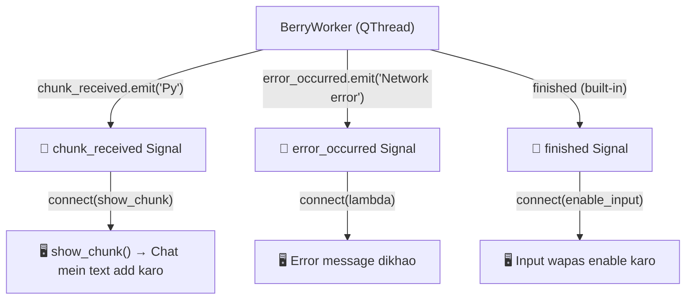

> [!NOTE]
> `finished_response` signal tumne define kiya hai lekin code mein use nahi ho raha. Instead, `QThread` ka built-in `finished` signal use ho raha hai (line 101: `worker.finished.connect(enable_input)`).
>
> `finished` QThread mein **already built-in** hota hai — jab `run()` method khatam hoti hai, yeh automatically fire hota hai!

##### Constructor:

```python
def __init__(self, message):
    super().__init__()         # QThread ka constructor call karo — ZARURI hai!
    self.message = message     # User ka message save karo — run() mein use hoga
```

##### Async Reply Function:

```python
async def get_reply(self):
    async for chunk in stream_berry(self.message):
        self.chunk_received.emit(chunk)
```

| Line | Kya Karta Hai |
|------|---------------|
| `async for chunk in stream_berry(...)` | `stream_berry` se chunks aate hain (yield hote hain) — har chunk pe loop chale |
| `self.chunk_received.emit(chunk)` | Har chunk aate hi **Signal fire** karo — "yeh naya chunk aaya hai, UI ko bhej do!" |

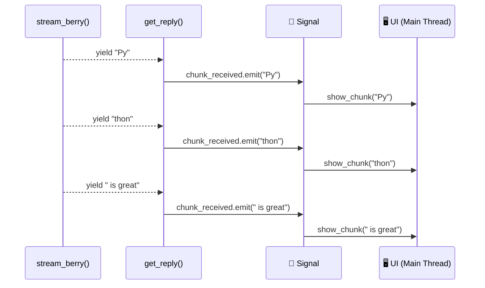

##### Run Method (Background Mein Chalta Hai):

```python
def run(self):
    try:
        asyncio.run(self.get_reply())
    except Exception as e:
        self.error_occurred.emit(str(e))
```

| Line | Kya Karta Hai |
|------|---------------|
| `def run(self)` | QThread ka special method — `worker.start()` call karne pe **background thread** mein chalta hai |
| `asyncio.run(self.get_reply())` | **Async duniya mein entry** — `get_reply()` async hai, `asyncio.run()` usse normal thread mein chalata hai |
| `except Exception as e` | Koi bhi error aaye toh pakad lo |
| `self.error_occurred.emit(str(e))` | Error signal fire karo — UI mein error message dikhega |

> [!IMPORTANT]
> **`asyncio.run()` kyun zaruri hai?**
>
> `run()` method ek **normal** (non-async) function hai. Lekin `get_reply()` **async** hai.
> Normal function se async function directly call nahi kar sakte!
>
> `asyncio.run()` = **Bridge** between normal Python ↔ async Python
>
> ```
> Normal Python (QThread.run)
>     │
>     ├── asyncio.run() ← BRIDGE 🌉
>     │       │
>     │       └── async def get_reply()
>     │               │
>     │               └── async for chunk in stream_berry()
>     │                       │
>     │                       └── yield chunk (from main.py)
> ```

---

#### Part C: UI Setup — Window Banana

```python
app = QApplication(sys.argv)
window = QWidget()
window.setWindowTitle("BERRY AI")
window.resize(800, 600)
```

| Line | Kya Karta Hai |
|------|---------------|
| `QApplication(sys.argv)` | Qt application start karo — **PEHLE** banana padta hai kuch bhi karne se |
| `QWidget()` | Ek basic window banao |
| `setWindowTitle("BERRY AI")` | Window ka title set karo |
| `resize(800, 600)` | Window ki size: 800px wide, 600px tall |

---

#### Part D: Chat Area — Messages Ka Display

```python
chat_area = QTextBrowser()
chat_area.setParent(window)
chat_area.setGeometry(30, 30, 740, 400)
chat_area.setLineWrapMode(QTextBrowser.LineWrapMode.WidgetWidth)
chat_area.setStyleSheet("""
QTextBrowser{
    background-color: #1e1e1e;
    color: #e6e6e6;
    border: none;
    padding: 12px;
    font-size: 14px;
}""")
```

| Line | Kya Karta Hai |
|------|---------------|
| `QTextBrowser()` | Rich text display widget — text dikhane ke liye (editable nahi hai by default) |
| `setParent(window)` | Isko main window ke andar lagao |
| `setGeometry(30, 30, 740, 400)` | Position (x=30, y=30) aur size (width=740, height=400) set karo |
| `setLineWrapMode(WidgetWidth)` | Lamba text automatically next line mein aaye — widget ki width ke hisab se |
| `setStyleSheet(...)` | CSS-like styling — dark theme laga raha hai |

| Style | Kya Karta Hai |
|-------|---------------|
| `background-color: #1e1e1e` | Dark background (almost black) |
| `color: #e6e6e6` | Light grey text |
| `border: none` | Koi border nahi |
| `padding: 12px` | Andar se 12px ki spacing |
| `font-size: 14px` | Text ka size |

---

#### Part E: Input Box + Button

```python
button = QPushButton("Click Me", window)
button.setGeometry(650, 450, 100, 45)

input_box = QLineEdit(window)
input_box.setPlaceholderText("Message BERRY...")
input_box.setGeometry(30, 450, 600, 45)
```

| Widget | Kya Hai |
|--------|---------|
| `QPushButton("Click Me", window)` | Ek button banao with text "Click Me", window ke andar |
| `QLineEdit(window)` | Text input field — user yahan type karega |
| `setPlaceholderText("Message BERRY...")` | Grey text dikhao jab input khali ho |
| `setGeometry(x, y, width, height)` | Position aur size set karo |

---

#### Part F: Helper Functions — Signals Ke Slots

```python
worker = None
```
> Global variable — currently running BerryWorker ka reference rakhta hai. `None` matlab abhi koi worker nahi chal raha.

##### `show_chunk()` — Chunk Ko Chat Mein Dikhao:

```python
def show_chunk(chunk):
    chat_area.moveCursor(QTextCursor.MoveOperation.End)
    chat_area.insertPlainText(chunk)
    chat_area.ensureCursorVisible()
```

| Line | Kya Karta Hai |
|------|---------------|
| `moveCursor(End)` | Cursor ko chat area ke **sabse end** mein le jao |
| `insertPlainText(chunk)` | Cursor ki current position pe chunk ka text **insert** karo |
| `ensureCursorVisible()` | Scroll karo taaki latest text dikhta rahe (auto-scroll) |

> [!NOTE]
> **`append()` vs `insertPlainText()` — Kyun `insertPlainText`?**
>
> - `chat_area.append("text")` → Har baar **NAYI LINE** mein text add karta hai
> - `chat_area.insertPlainText("text")` → **SAME LINE** mein text add karta hai
>
> Streaming mein hum chahte hain ki chunks **ek hi line** mein aayein (jaise ChatGPT mein hota hai), isliye `insertPlainText` use karte hain!
>
> ```
> ❌ append() se:                 ✅ insertPlainText() se:
> BERRY: Py                       BERRY: Python is great
> thon
> is
> great
> ```

##### `enable_input()` — Input Wapas Enable Karo:

```python
def enable_input():
    input_box.setEnabled(True)
    button.setEnabled(True)
    input_box.setFocus()
```

Jab Berry ka reply poora ho jaaye, input box aur button wapas enable karo aur input box pe focus de do.

---

#### Part G: `send_message()` — Sab Ko Jodne Wala Function ⭐⭐⭐

```python
def send_message():
    global worker
    message = input_box.text().strip()
    if not message:
        return

    chat_area.append(f"You: {message}")
    chat_area.append("BERRY: ")

    input_box.clear()
    input_box.setEnabled(False)
    button.setEnabled(False)

    worker = BerryWorker(message)
    worker.chunk_received.connect(show_chunk)
    worker.error_occurred.connect(lambda e: show_chunk(f"\nError: {e}"))
    worker.finished.connect(enable_input)
    worker.start()
```

Step by step:

| Step | Code | Kya Karta Hai |
|------|------|---------------|
| 1 | `global worker` | Global `worker` variable use karo (taaki garbage collect na ho) |
| 2 | `input_box.text().strip()` | Input box se text lo aur extra spaces hatao |
| 3 | `if not message: return` | Agar khali hai toh kuch mat karo |
| 4 | `chat_area.append(f"You: {message}")` | Chat mein user ka message dikhao |
| 5 | `chat_area.append("BERRY: ")` | Nayi line mein "BERRY: " likho — iske baad chunks aayenge |
| 6 | `input_box.clear()` | Input box khali karo |
| 7 | `input_box.setEnabled(False)` | Input box disable karo (Berry soch raha hai — user wait kare) |
| 8 | `button.setEnabled(False)` | Button bhi disable karo |
| 9 | `worker = BerryWorker(message)` | Naya worker banao with user ka message |
| 10 | `worker.chunk_received.connect(show_chunk)` | 🔗 "Jab chunk aaye → `show_chunk` call karo" |
| 11 | `worker.error_occurred.connect(...)` | 🔗 "Jab error aaye → error message dikhao" |
| 12 | `worker.finished.connect(enable_input)` | 🔗 "Jab kaam khatam ho → input wapas enable karo" |
| 13 | `worker.start()` | 🚀 **Worker ko background mein START karo!** |

> [!IMPORTANT]
> **`worker.start()` vs `worker.run()` — BAHUT IMPORTANT FARAK!**
>
> | Method | Kya Hota Hai |
> |--------|-------------|
> | `worker.start()` ✅ | **Naya thread** banata hai aur `run()` us thread mein chalata hai — UI freeze NAHI hogi! |
> | `worker.run()` ❌ | `run()` ko **main thread mein hi** chala dega — UI FREEZE ho jayegi! |
>
> Hamesha `.start()` use karo, kabhi directly `.run()` mat call karo!

---

#### Part H: Event Connections + App Start

```python
button.clicked.connect(send_message)
input_box.returnPressed.connect(send_message)

window.show()
sys.exit(app.exec())
```

| Line | Kya Karta Hai |
|------|---------------|
| `button.clicked.connect(send_message)` | Button click pe `send_message` call karo |
| `input_box.returnPressed.connect(send_message)` | Enter key press pe `send_message` call karo |
| `window.show()` | Window dikhao! |
| `sys.exit(app.exec())` | Qt event loop start karo — app tab tak chale jab tak window band na ho |

> [!NOTE]
> `app.exec()` = Qt ka **event loop** — yeh continuously dekhta rehta hai "koi button click hua? mouse move hua? window resize hua?" aur accordingly functions call karta hai. Yeh loop HAMESHA main thread mein chalta hai.

---

## 🔄 POORA FLOW — Jab User Message Bhejta Hai

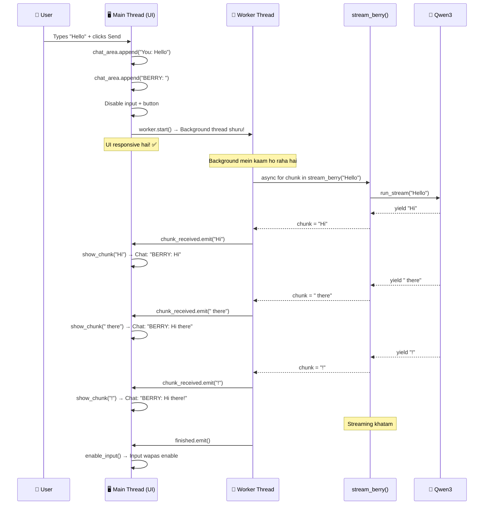

---

## 🧩 Key Concepts Summary — Quick Revision

| # | Concept | Ek Line Mein |
|---|---------|--------------|
| 1 | **Streaming** | AI ka reply thoda thoda aata hai — `run_stream()` + `stream_text(delta=True)` |
| 2 | **Buffer** | Saare chunks ko ek string mein jodna — `buffer += chunk` |
| 3 | **async/await** | Bina block kiye wait karna — async functions ke liye |
| 4 | **yield** | Function se values ek ek karke dena — generator banata hai |
| 5 | **asyncio.run()** | Normal Python se async Python mein jaane ka bridge |
| 6 | **QThread** | Background thread — heavy kaam yahan karo, UI freeze nahi hogi |
| 7 | **Signal** | Thread-safe messaging — background se UI ko data bhejne ka safe tarika |
| 8 | **emit()** | Signal fire karo — connected function call hoga |
| 9 | **connect()** | Signal ko function se jodo — "jab yeh ho, toh yeh karo" |
| 10 | **delta=True** | Sirf naya chunk do, poora accumulated text nahi |

---

## 🏗️ Architecture Overview — Sab Ek Saath

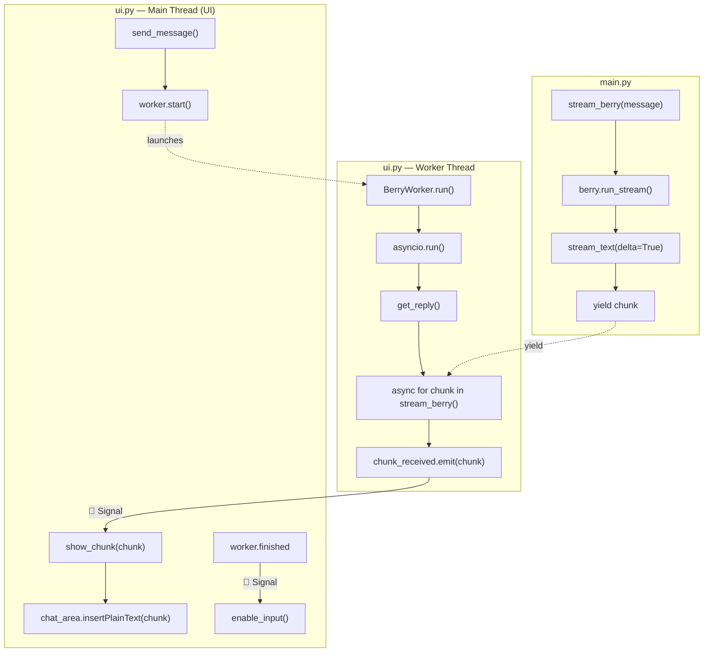

---

> [!TIP]
> **Quick Recap Formula:**
> ```
> Berry Streaming UI =
>     stream_berry() (async generator — chunks yield karta hai)
>   + BerryWorker (QThread — background mein chalta hai)
>   + Signals (chunk_received, finished — safely UI update)
>   + show_chunk() (chat area mein text add karta hai)
>   + send_message() (sab ko connect karke start karta hai)
> ```
> Bas itna hi hai bro! 🫐
